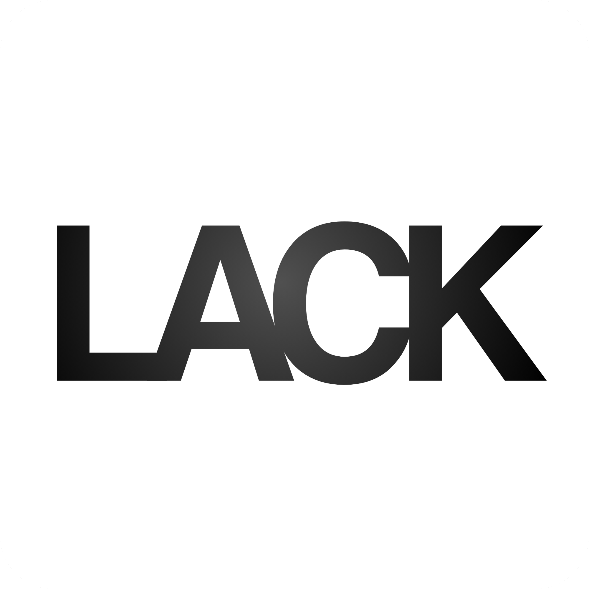

<div align="center">
  
  <br />
  
  <br /><br />
  <p><strong>L'editor LaTeX desktop moderno, potente e collaborativo parte della stessa suite di Mark.</strong></p>

  []()
  [](LICENSE)
  []()
  [-brightgreen.svg)]()
</div>

---

## 🌟 Panoramica

**Lack** è l'editor per LaTeX progettato per offrire un'esperienza fluida, potente e completa, ispirata alle migliori funzionalità di **Overleaf Pro** e **TeXstudio**, pur mantenendo lo **stesso identico stile grafico, ergonomia, eleganza e pulizia di Mark** (l'editor Markdown della stessa suite).

Lack include tutto ciò che serve per la redazione di documenti accademici, tesi di laurea, articoli di conferenza, slide Beamer e report tecnici:
- **Nessun limite di compilazione** (tempo e numero di build illimitati).
- **Collaborazione peer-to-peer illimitata e gratuita** tramite Yjs e WebRTC (nessun abbonamento, crittografia E2EE opzionale).
- **Compilazione istantanea** con supporto per tutti i motori TeX di sistema (`pdfLaTeX`, `XeLaTeX`, `LuaLaTeX`, `Tectonic`, `Latexmk`) e un **motore integrato ultra-rapido** che non richiede configurazioni per iniziare a scrivere subito.
- **Pannello Errori & Log in stile Overleaf**: visualizzazione di errori e avvisi con conteggio e salto automatico alla riga con un clic.
- **Autocompletamento intelligente** per tutti i comandi `\xxx`, ambienti matematici, lettere greche e snippet con tab-stop.
- **Galleria Template completa** (IEEE, Report Universitari, Presentazioni Beamer, Tesi, CV e Problem Set) con drawer di anteprima e salvataggio di template personalizzati.
- **Visualizzatore PDF integrato** con zoom, navigazione per pagina, download rapido e sincronizzazione della posizione.
- **Temi coordinati**: Scuro (Dark), Chiaro (Light) e GitHub, identici a Mark.

---

## 🚀 Funzionalità Principali

### ⚡ Compilazione Senza Limiti
- Pulsante di ricompilazione in evidenza in stile Overleaf (`Ctrl + Enter`).
- Rilevamento automatico dei motori installati nel sistema (`pdfLaTeX`, `XeLaTeX`, `LuaLaTeX`, `Tectonic`, `Latexmk`).
- Configurazione semplificata di percorsi personalizzati del compilatore.
- Modalità di compilazione automatica in tempo reale (`Auto-compile`) con debounce intelligente o al salvataggio del file.
- Pulizia automatica opzionale dei file ausiliari (`.aux`, `.log`, `.out`, `.toc`, `.fls`).

### 🛠️ Pannello Errori e Diagnostica TeX
- Cassetto espandibile dei log (`Ctrl + Shift + U`) con badge colorati per errori (rossi) e avvisi (gialli).
- Salto immediato alla riga interessata cliccando sulla card dell'errore.
- Visualizzatore del log raw TeX per il debug avanzato di pacchetti e macro.

### 💡 Autocompletamento LaTeX Intelligente
- Digitando `\` viene mostrato un menu fluttuante con oltre 130 comandi essenziali divisi per categoria (*Struttura, Ambienti, Matematica, Stile, Simboli Greci, Citazioni*).
- Inserimento rapido di formule matematiche inline (`$...$`), display (`\[...\]`), frazioni (`\frac{}{}`), radici quadrate (`\sqrt{}`) e palette dei simboli greci.
- Chiusura automatica intelligente di parentesi graffe `{}`, dollari `$`, parentesi quadre `[]` e indentazione automatica degli ambienti `\begin{} ... \end{}`.
- Avvolgimento della selezione senza cancellazione del testo esistente.

### 👥 Collaborazione P2P Gratuita e Illimitata
- Collaborazione in tempo reale basata su CRDT (Yjs) e connessione diretta WebRTC.
- Nessun server proprietario né costo per utente: crea una stanza con codice `lack-xxxxxx` e condividila con colleghi o compagni di studio.
- Contatore in tempo reale dei partecipanti connessi e cursore sincronizzato.

### 📚 Galleria Template in stile Overleaf
- **Academic & Papers**: Articolo di conferenza IEEE Transactions (a due colonne).
- **University & Lab Reports**: Relazione tecnica di laboratorio con frontespizio, abstract e tabelle.
- **Presentations (Beamer)**: Slide deck moderno per presentazioni accademiche o aziendali.
- **Theses & Books**: Struttura completa per tesi di Laurea Triennale, Magistrale o Dottorato di Ricerca.
- **Curriculum Vitae**: CV professionale e accademico pulito e strutturato.
- **Assignments & Math**: Fogli di esercizi e problem set matematici con box per le soluzioni.
- Possibilità di salvare qualsiasi documento corrente come template personalizzato riutilizzabile.

---

## 💻 Installazione

Lack include script di installazione dedicati e automatizzati per **Ubuntu / Linux**, **macOS** e **Windows**.

### 🐧 Ubuntu / Debian / Linux
Esegui lo script `lin-install.sh` dalla cartella del progetto:
```bash
./lin-install.sh
```
Lo script:
1. Installa le dipendenze e compila l'applicazione.
2. Copia i file in `/opt/lack/` e configura i permessi sandbox (`chrome-sandbox`).
3. Compila `lack.c` in `/usr/local/bin/lack` per avviare l'editor direttamente da terminale in background senza bloccare la shell:
   ```bash
   lack documento.tex
   lack /percorso/alla/cartella_progetto/
   ```
4. Registra l'icona e crea il file `.desktop` nel launcher delle applicazioni di sistema.

### 🍎 macOS
Esegui lo script `mac-install.sh`:
```bash
./mac-install.sh
```
Lo script:
1. Verifica Homebrew e Node.js.
2. Compila l'applicazione e genera il file DMG o `.app`.
3. Crea il comando da terminale `/usr/local/bin/lack` per l'avvio globale.

### 🪟 Windows
Fai doppio clic o esegui dal prompt dei comandi lo script `win-install.bat`:
```cmd
win-install.bat
```
Lo script:
1. Esegue il build dell'applicazione per Windows.
2. Copia i file in `%LOCALAPPDATA%\Programs\Lack\`.
3. Crea i collegamenti sul Desktop e nel Menu Start.
4. Associa automaticamente l'estensione `.tex` a Lack.

---

## ⌨️ Scorciatoie da Tastiera Principali

| Scorciatoia | Azione |
| :--- | :--- |
| `Ctrl + Enter` | **Compila / Ricompila documento LaTeX** |
| `Ctrl + Shift + U` | **Mostra / Nascondi Pannello Log ed Errori** |
| `Ctrl + N` | Nuovo documento LaTeX |
| `Ctrl + O` | Apri file LaTeX |
| `Ctrl + Shift + O` | Apri cartella progetto |
| `Ctrl + S` | Salva documento |
| `Ctrl + Shift + T` | Salva file corrente come template |
| `Ctrl + T` | Sfoglia la Galleria Template |
| `Ctrl + W` | Chiudi scheda attiva |
| `Ctrl + F` | Cerca nel documento LaTeX |
| `Ctrl + R` | Mostra / Nascondi pannello Explorer |
| `Ctrl + Shift + L` | Modalità Solo Editor |
| `Ctrl + Shift + K` | Modalità Vista Divisa (Split View) |
| `Ctrl + Shift + P` | Modalità Solo Anteprima PDF |
| `Ctrl + M` | Cambia tema (Chiaro / Scuro / GitHub) |
| `Ctrl + +` / `Ctrl + -` | Ingrandisci / Riduci zoom |
| `Ctrl + 0` | Ripristina zoom predefinito |

---

## 📦 Motori TeX e Compilatori Consigliati

Lack supporta qualsiasi compilatore TeX standard. Per la massima compatibilità con tutti i pacchetti LaTeX liberi:

- **Ubuntu / Debian**:
  ```bash
  sudo apt update
  sudo apt install -y texlive-latex-base texlive-latex-extra texlive-fonts-recommended tectonic
  ```
- **macOS**:
  ```bash
  brew install tectonic
  # oppure distribuzione completa:
  brew install --cask mactex-no-gui
  ```
- **Windows**:
  ```cmd
  winget install Tectonic.Tectonic
  # oppure MiKTeX:
  winget install MiKTeX.MiKTeX
  ```

Se nessun motore nativo è installato, Lack utilizzerà automaticamente il suo **motore interno integrato ad alta velocità** basato su KaTeX e web-rendering, permettendo di iniziare immediatamente a scrivere senza attese.

---

## 📄 Licenza

Distribuito sotto licenza [ISC](LICENSE). Sviluppato come parte della suite coordinata con **Mark**.
