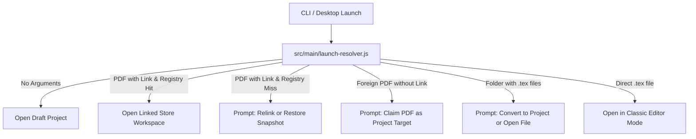
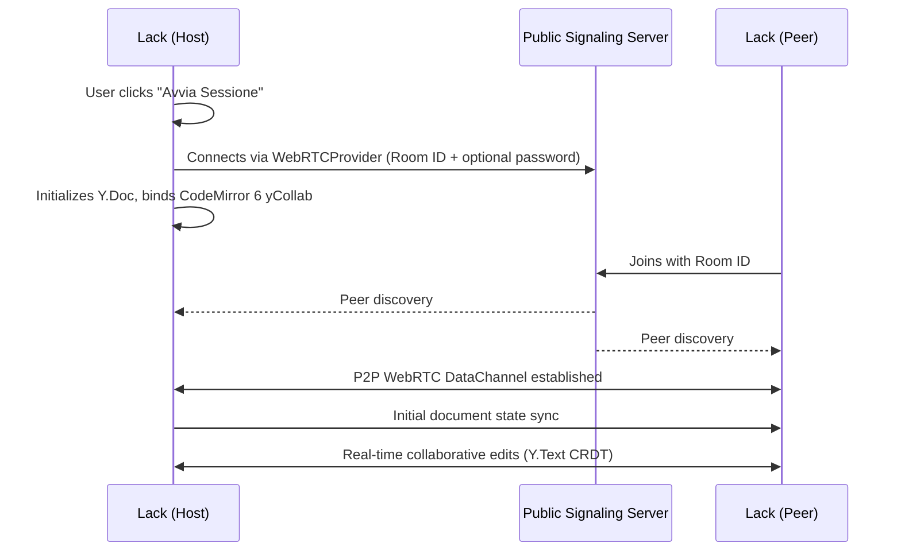

# Lack System Architecture

Lack is a professional LaTeX editor desktop application built on Electron, CodeMirror 6, and modern web technologies. This document defines the module map, process boundaries, IPC channel protocols, state ownership, and data flows.

---

## 1. Module Map

```
lack/
├── main.js                      # Electron Main Process entry point & lifecycle
├── renderer.js                  # Electron Renderer Process orchestrator
├── collaboration.js             # Real-time P2P WebRTC collaboration (Yjs)
├── latex-compiler.js            # TeX compilation dispatcher (Tectonic, pdflatex, AST)
├── pdf-viewer.js                # PDF.js viewer, rendering queue, SyncTeX engine
├── templates.js                 # Curated LaTeX templates (IEEE, article, beamer, etc.)
├── i18n.js                      # Internationalization (Italian & English)
├── src/
│   ├── main/
│   │   ├── cli.js               # CLI argument parser & launch argument resolver
│   │   ├── engine-installer.js  # Tectonic 1-click automatic downloader & unpacker
│   │   ├── launch-resolver.js   # Decision table for project/PDF/folder launch
│   │   └── window-chrome.js     # Window frame styling (macOS, GNOME, Windows)
│   ├── editor/
│   │   ├── index.js             # CodeMirror 6 facade & extension composition
│   │   ├── autocomplete.js      # Overleaf-style 4-tier completion provider
│   │   ├── autopair.js          # Bracket/math auto-closing & env auto-pair
│   │   ├── latex-syntax.js      # Lezer/StreamLanguage LaTeX grammar
│   │   ├── linter.js            # In-editor error squiggles & diagnostics
│   │   ├── linter-logic.js      # Pure validation logic & diagnostic parser
│   │   ├── spellcheck.js        # Spellcheck coordinator
│   │   ├── spell.worker.js      # Bilingual Web Worker (Hunspell / nspell)
│   │   ├── spell-tokenizer.js   # TeX-aware word segmenter
│   │   └── themes.js            # Theme extensions (Light, Dark, GitHub)
│   ├── compiler/
│   │   └── ast-renderer.js      # Pure JS built-in LaTeX-to-HTML AST renderer
│   ├── viewer/
│   │   └── fit-calculator.js    # Responsive zoom, fit-width, fit-page logic
│   └── projects/
│       ├── manager.js           # Project workspace manager (create, lock, manifest)
│       ├── registry.js          # Global projects.json registry & auto-healing
│       ├── pdf-link.js          # PDF /PieceInfo metadata embedding & snapshot zip
│       ├── import.js            # Folder-to-project & standalone import logic
│       ├── recents.js           # MRU history manager with path existence filter
│       └── ui-controller.js     # Explorer virtual DOM, multi-selection, inline rename
```

---

## 2. Process Boundaries & IPC Channel Table

Electron enforces strict process isolation between the Node.js **Main Process** (`main.js`) and the Chromium **Renderer Process** (`renderer.js`).

| IPC Channel | Direction | Payload Schema | Handler | Validation & Path Confinement |
|---|---|---|---|---|
| `window-minimize` | Renderer → Main | None | `win.minimize()` | N/A |
| `window-maximize` | Renderer → Main | None | `win.maximize()` / `win.unmaximize()` | N/A |
| `window-close` | Renderer → Main | None | Checks dirty tabs, sends prompt | N/A |
| `window-close-confirmed` | Renderer → Main | None | `win.destroy()` | N/A |
| `set-window-controls-style` | Renderer → Main | `style: "gnome"\|"macos"\|"windows"` | Reconfigures frame & titleBarOverlay | Enum string check |
| `update-theme-menu-label` | Renderer → Main | `isDark: boolean` | Updates Native Menu title | Boolean check |
| `get-platform` | Renderer → Main (sync) | None | Returns `process.platform` | Synchronous getter |
| `is-window-maximized` | Renderer → Main (sync) | None | Returns `win.isMaximized()` | Synchronous getter |
| `detect-latex-engines` | Renderer → Main | None | Checks PATH for `tectonic`, `pdflatex`, etc. | Read-only |
| `compile-latex` | Renderer → Main | `{ sourcePath, engine, cleanAux, outputDir }` | Spawns engine CLI or returns AST fallback | Validates sourcePath exists, sanitizes args |
| `stop-compilation` | Renderer → Main | None | Kills active compilation child process | Process PID check |
| `get-install-command` | Renderer → Main | None | Returns OS-specific package manager cmd | N/A |
| `install-tectonic` | Renderer → Main | None | Downloads Tectonic binary to userData | Confined to app.getPath('userData') |
| `project-get-store-root` | Renderer → Main | None | Returns default or configured store path | N/A |
| `project-set-store-root` | Renderer → Main | `newRoot: string` | Updates configured storeRoot directory | Confines to absolute directory |
| `project-create` | Renderer → Main | `{ name, template, targetPdfPath }` | Creates store folder, manifest, main.tex | Sanitizes item name, confirms safe path |
| `project-load-manifest` | Renderer → Main | `storePath: string` | Reads `lack.json` | Ensures path is inside storeRoot |
| `project-save-manifest` | Renderer → Main | `storePath: string, manifest: object` | Writes `lack.json` | Confines to project root |
| `project-list` | Renderer → Main | None | Returns all registry entries | Read-only |
| `project-relink` | Renderer → Main | `{ pdfPath, projectId }` | Embeds Lack metadata into PDF | Checks PDF file existence |
| `project-unlink` | Renderer → Main | `pdfPath: string` | Removes metadata from PDF | Verifies PDF exists |
| `project-post-process-compile` | Renderer → Main | `{ projectId, pdfSource, targetPdfPath }` | Moves PDF, embeds link & snapshot | Target collision check & atomic write |
| `project-read-link` | Renderer → Main | `pdfPath: string` | Reads `/PieceInfo` dictionary | Read-only PDF parsing |
| `project-registry-lookup` | Renderer → Main | `idOrTarget: string` | Finds project by id or target PDF | Read-only |
| `project-registry-remove` | Renderer → Main | `projectId: string` | Removes entry from `projects.json` | String ID check |
| `project-registry-save` | Renderer → Main | `payload: ProjectRecord` | Saves project entry | Validates manifest schema |
| `project-extract-snapshot` | Renderer → Main | `{ pdfPath, targetDir }` | Unpacks embedded zip | Confines to targetDir |
| `project-add-linked-asset` | Renderer → Main | `{ storePath, sourcePath, relDest }` | Copies external asset into project | Validates path confinement |
| `project-export` | Renderer → Main | `{ storePath, exportDest, asZip }` | Copies or zips project files | Confined write |
| `project-trash-item` | Renderer → Main | `itemPath: string` | Moves item to system trash | Ensures path is within workspace |
| `project-restore-trash` | Renderer → Main | `record: object` | Restores trashed item | Path validation |
| `project-reveal-item` | Renderer → Main | `itemPath: string` | Calls `shell.showItemInFolder()` | File existence check |
| `project-acquire-lock` | Renderer → Main | `{ storePath, windowId }` | Writes `.lack.lock` | PID and process check |
| `project-release-lock` | Renderer → Main | `storePath: string` | Removes `.lack.lock` | Confined to project store |
| `project-is-folder-declined`| Renderer → Main | `folderPath: string` | Checks if folder conversion declined | Path normalization |
| `project-decline-folder` | Renderer → Main | `folderPath: string` | Records declined folder | Path normalization |
| `project-scan-folder` | Renderer → Main | `folderPath: string` | Returns list of `.tex` files in folder | Confined readdir |
| `project-convert-folder` | Renderer → Main | `{ folderPath, mainFileName, projectTitle }` | Converts folder with safe copy & journal | SHA-256 + size verify, move journal |
| `project-undo-move` | Renderer → Main | `journalPath: string` | Reverts file moves from journal | Journal signature check |
| `app-language-changed` | Renderer → Main | `lang: "it"\|"en"` | Rebuilds native application menus | Enum check |

---

## 3. State Ownership

1. **Main Process (`main.js`)**:
   - Window lifecycle, native menus, single instance lock.
   - Project Registry (`projects.json` in `userData`).
   - Project Lock Manager (`.lack.lock` per active workspace).
   - Compiler child processes and engine installations.
   - System clipboard, native file dialogues, and shell integration.

2. **Renderer Process (`renderer.js`)**:
   - Tab Manager (`tabs[]`, `activeTabId`, dirty flags).
   - CodeMirror 6 Editor state (`EditorView`, compartments, dispatch).
   - Active project workspace state (`currentProject`, `currentProjectDir`, `mainDocumentPath`).
   - PDF.js viewer state (`currentPdfDoc`, scale, active page, render queue).
   - Compiler issues list and log console drawer.
   - P2P Collaboration state (`ydoc`, `yText`, `provider`, online peers).

3. **Persistent LocalStorage (`localStorage`)**:
   - `lack-theme`: Active theme (`light`, `dark`, `github`).
   - `lack.lang`: Interface language (`it`, `en`).
   - `lack-engine`: Selected LaTeX engine (`tectonic`, `pdflatex`, `xelatex`, `lualatex`, `ast`).
   - `lack-autoCompile`: Automatic compilation switch (boolean).
   - `lack-compileOnSave`: Compile on Ctrl+S switch (boolean).
   - `lack-lineWrapping`: Editor soft wrap switch (boolean).
   - `lack-vimMode`: Vim keybindings switch (boolean).
   - `lack-fontSize`: Base editor font size in pixels.
   - `lack-windowControlsStyle`: Window buttons style (`gnome`, `macos`, `windows`).

---

## 4. Key Data Flows

### A. Launch & Open Resolution


### B. Compile & Post-Processing
1. **Trigger**: Ctrl+S (if compile-on-save enabled), Ctrl+B, "Compila" button, or Auto-compile timer (3s debounce).
2. **Execution**: Renderer invokes `compile-latex` with source file, engine, and flags.
3. **Engine**:
   - If `tectonic` / `pdflatex` / `xelatex` / `lualatex`: spawns CLI, captures stdout/stderr, parses log for LaTeX errors (`error-parser.js`).
   - If `ast` or engine missing: compiles in pure JS via `ast-renderer.js` to structured HTML.
4. **Post-Processing** (`project-post-process-compile`):
   - Atomically verifies compiled PDF.
   - Checks target collision: if target exists and is unlinked, assigns `uniqueName(..., '-1.pdf')`.
   - Embeds `/PieceInfo/Lack` metadata and snapshot zip into PDF.
   - Updates `projects.json` registry with compilation timestamp.
5. **Viewer Update**: PDF.js re-renders active page, preserves scroll/fit mode, and updates SyncTeX coordinate mappings.

### C. Real-Time Collaboration (P2P WebRTC)


---

## 5. Architectural Divergences from Mark

| Component | Mark (`/home/sgabelli/github/mark`) | Lack (`/home/sgabelli/github/lack`) | Classification | Reason / Solution |
|---|---|---|---|---|
| **Editor Core** | Native `<textarea>` with manual cursor manipulation | CodeMirror 6 with modular extensions, syntax tree, and linting | **Intentional** | LaTeX requires advanced gutter diagnostics, fold service, and semantic tokens. |
| **Viewer** | Live Markdown HTML preview (`marked.js` + KaTeX) | Hybrid: PDF.js 3.11 canvas viewer with SyncTeX + built-in AST preview | **Intentional** | LaTeX produces publication-grade PDFs; SyncTeX provides bi-directional cursor sync. |
| **Project Model** | Single document file | Linked Projects (`.lack` store + embedded metadata in PDF) | **Intentional** | Preserves standalone portable PDFs while enabling modular multi-file LaTeX projects. |
| **Collab Sync** | String diff calculation applied to textarea | Yjs `y-codemirror.next` extension + shared CRDT | **To-Fix (Refined)** | Lack must dynamically load collaboration, provide visible connection test, and prevent unbundled CM6 state conflicts. |
| **Window Chrome** | Custom HTML buttons styled per OS | Native titlebar overlay on Windows/macOS + custom on Linux | **Intentional** | Matches platform conventions while allowing user customization. |
| **Autocomplete** | None | Overleaf-style 4-tier ranking with signature help & doc panel | **To-Fix (Refined)** | Eliminate fuzzy subsequence underlines, match Overleaf UI layout. |

---

## 6. "Where to Change X" Index

- **Add/modify LaTeX Autocomplete commands**: `data/latex-commands.json`, `data/builtin-macros.json`, `src/editor/autocomplete.js`.
- **Change Editor Behavior / Keymaps**: `src/editor/index.js`, `src/editor/autopair.js`.
- **Modify Compiler Engines & Detection**: `latex-compiler.js`, `data/engines.json`, `src/main/engine-installer.js`.
- **Adjust PDF Viewer & SyncTeX**: `pdf-viewer.js`, `src/viewer/fit-calculator.js`.
- **Change Project Storage & Metadata**: `src/projects/manager.js`, `src/projects/pdf-link.js`, `src/projects/registry.js`.
- **UI Styling & Themes**: `themes.css` (tokens), `style.css` (layout), `src/editor/themes.js`.
- **Internationalization (Translations)**: `i18n.js`.
